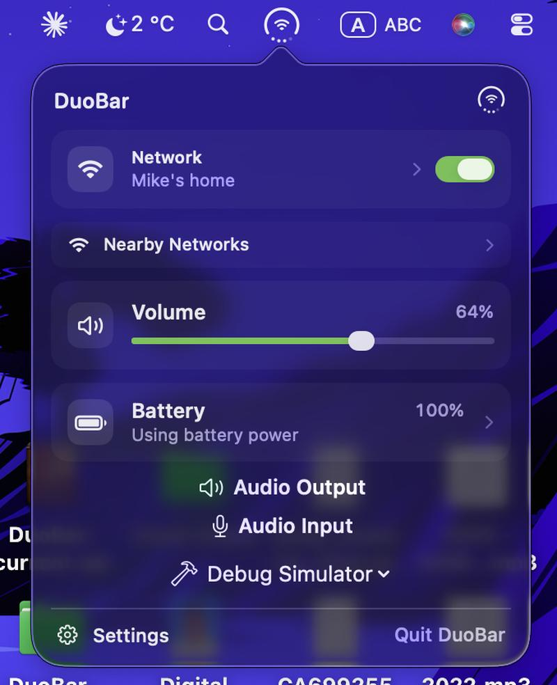

# DuoBar

### ตัวบ่งชี้แถบเมนู macOS ขนาดกะทัดรัดสำหรับแบตเตอรี่ เครือข่าย และระดับเสียง

**สามสถานะสด หนึ่งสัญลักษณ์ แถบเมนูไม่รกอีกต่อไป**

[English](README.md) | [简体中文](README.zh-CN.md) | [Русский](README.ru.md) | [Українська](README.uk.md) | [ไทย](README.th.md)

[**ดาวน์โหลด DuoBar 1.3.2**](https://github.com/Mikeli7666/DuoBar/releases/download/v1.3.2/DuoBar-1.3.2.dmg) · [**รุ่นทั้งหมด**](https://github.com/Mikeli7666/DuoBar/releases) · [**แจ้งข้อบกพร่อง**](https://github.com/Mikeli7666/DuoBar/issues)

DuoBar 1.3.2 (Build 8) · macOS 13+ · Apple Silicon หรือ Intel · Universal 2 · ฟรีและโอเพนซอร์ส

 

  
▶ [watch the launch film of the latest version on YouTube](https://youtube.com/shorts/-4Y8rq3SGGg)

## หนึ่งสัญลักษณ์ สามสถานะสด

DuoBar นำแนวคิดสถานะสามในหนึ่งสไตล์ iPhone Duo มาสู่แถบเมนูของ Mac สัญลักษณ์ขนาดกะทัดรัดเพียงหนึ่งเดียวแสดงข้อมูลระบบที่ปกติจะกระจายอยู่ตามตัวบ่งชี้หลายตัว:

- **วงแหวนรอบนอก** → วงแหวนแบตเตอรี่สดบน MacBook หรือวงแหวนปรับตัวบน Mac ตั้งโต๊ะ
- **ตรงกลาง** → เครือข่ายที่ใช้งานอยู่: Wi-Fi อีเธอร์เน็ต หรือสถานะออฟไลน์/สำรอง
- **จุดสี่จุดด้านล่าง** → ระดับเสียงเอาต์พุตสด

สถานะถาวรจะคงสีเดียวและดูเป็นธรรมชาติ เมื่อ AirPods หรืออุปกรณ์เสียงบลูทูธที่รองรับเริ่มทำงาน ตรงกลางจะเปลี่ยนจากเครือข่าย → AirPods/หูฟัง → เครือข่ายชั่วคราว การตัดการเชื่อมต่อจะไม่ทำให้เกิดแอนิเมชัน

  

## วงแหวนปรับตัวและวงแหวนแบตเตอรี่

บน MacBook วงแหวนแบตเตอรี่รอบนอกจะแสดงระดับแบตเตอรี่สด สายฟ้าชาร์จแบบไดนามิก และรหัสสีแบตเตอรี่เสริมสำหรับสถานะกำลังชาร์จ โหมดพลังงานต่ำ และแบตเตอรี่ต่ำ บน Mac ตั้งโต๊ะ วงแหวนปรับตัวจะคงสถานะเป็นกลางเมื่อไม่มีกิจกรรมด้านประสิทธิภาพที่มีความหมาย และจะแสดงแรงกดดันด้าน CPU หน่วยความจำ หรือความร้อนที่ยั่งยืนโดยอัตโนมัติเมื่อเหมาะสม โดยยังคงทำงานอัตโนมัติ: ไม่มีตัวเลือกเมตริกด้วยตนเอง

## DuoBar บน macOS

รุ่น 1.3.2 ปัจจุบันรวมพื้นฐานแบตเตอรี่ เครือข่าย และระดับเสียงเข้ากับพฤติกรรมวงแหวนปรับตัวของ MacBook การควบคุมที่ปรับปรุง ขนาดไอคอนที่ปรับได้ และการติดตั้งที่ราบรื่น

## คุณสมบัติ

- วงแหวนแบตเตอรี่พร้อมระดับสด สายฟ้าชาร์จแบบไดนามิก สถานะแบตเตอรี่ต่ำ และรหัสสีแบตเตอรี่เสริม
- วงแหวนปรับตัวสำหรับ Mac ตั้งโต๊ะ: เป็นกลางตามค่าเริ่มต้น พร้อมการรับรู้แรงกดดัน CPU หน่วยความจำ และความร้อนโดยอัตโนมัติ
- ภาษาภาพ Duo ดั้งเดิมที่ปรับปรุง ตัวบ่งชี้ Wi-Fi แบบมน วงแหวนแบตเตอรี่ ตัวบ่งชี้ระดับเสียง และการนำเสนอการชาร์จ
- สถานะเครือข่าย Wi-Fi อีเธอร์เน็ต และออฟไลน์อัตโนมัติ
- การแสดงชื่อเครือข่าย Wi-Fi และการควบคุมพลังงาน Wi-Fi สาธารณะ
- พฤติกรรมป๊อปอัปเปิดเมื่อโฮเวอร์เสริม
- ตัวบ่งชี้ระดับเสียงสดสี่จุด
- แถบเลื่อนระดับเสียงขนาดกะทัดรัด การปิดเสียง Core Audio สาธารณะ และการสลับอุปกรณ์เอาต์พุตในที่ที่รองรับ
- การนำเสนอการเชื่อมต่อ AirPods/หูฟังชั่วคราว
- ขนาดไอคอนแถบเมนูที่ปรับได้
- ภาษาอังกฤษ รัสเซีย ยูเครน จีนตัวย่อ จีนตัวเต็ม และภาษาไทย
- ป๊อปอัปแบบกำหนดเองขนาดกะทัดรัด: เครือข่ายและแบตเตอรี่เปิดการตั้งค่าระบบ พลังงาน Wi-Fi ระดับเสียง การเลือกเอาต์พุตเสียง การตั้งค่า และออก
- โหมดสว่างและโหมดมืด
- เปิดเมื่อเข้าสู่ระบบ
- Universal 2: รองรับ Apple Silicon และ Intel บน macOS 13+
- Swift, SwiftUI และ AppKit ดั้งเดิม
- ไม่มีไอคอน Dock

## ความต้องการของระบบ

**macOS 13.0+** 
**Apple Silicon หรือ Intel**

## การติดตั้ง

1. เปิด [รุ่น DuoBar 1.3.2](https://github.com/Mikeli7666/DuoBar/releases/tag/v1.3.2) และค้นหา **Assets**
2. ดาวน์โหลด **DuoBar-1.3.2.dmg** อย่าดาวน์โหลด `Source code (zip)` หรือ `Source code (tar.gz)`
3. ดับเบิลคลิก DMG แล้วลาก **DuoBar.app** ไปยัง **Applications**
4. เปิด Applications แล้วเปิด DuoBar เป็นยูทิลิตี้แถบเมนูและปกติจะไม่ปรากฏใน Dock

DuoBar 1.3.2 ใช้การลงนาม Developer ID, Hardened Runtime และการรับรอง Apple การติดตั้งปกติไม่จำเป็นต้องปิด Gatekeeper/SIP, Terminal, `sudo` หรือ `xattr`

SHA-256: `18b878391eeab47a53c4ae0b51d10ae0468a8d7d489b5ae056f6cd5281053bae`

งานสร้างและความเข้ากันได้/ความน่าเชื่อถือได้รับการตรวจสอบโดยใช้ Xcode 27 และ macOS 27 SDK ในขณะที่ยังคงรองรับ macOS 13+ ต่อไป ซึ่งไม่ได้อ้างถึงการตรวจสอบฮาร์ดแวร์ macOS 27

## สิทธิ์การเข้าถึง

- **ตำแหน่งที่ตั้ง:** macOS อาจต้องการการอนุญาตก่อนที่ CoreWLAN จะเปิดเผยชื่อเครือข่าย Wi-Fi ปัจจุบัน การปฏิเสธการเข้าถึงจะไม่ทำให้การเชื่อมต่อพื้นฐาน อินเทอร์เฟซ หรือสถานะสัญญาณเสียหาย ชื่อ SSID อาจไม่สามารถใช้งานได้เท่านั้น DuoBar จะขอการเข้าถึง SSID เฉพาะเมื่อมีประโยชน์ต่ออินเทอร์เฟซ
- **บลูทูธ:** DuoBar ยังคงสังเกตตัวควบคุมบลูทูธสาธารณะในขณะที่ Core Audio เป็นแหล่งหลักสำหรับปลายทางเสียงบลูทูธ แอปไม่ได้จัดการหรือจับคู่อุปกรณ์

## พฤติกรรมเสียงเอาต์พุต

การควบคุมระดับเสียงจะใช้งานได้เฉพาะเมื่อเอาต์พุต Core Audio ที่ใช้งานอยู่เปิดเผยคุณสมบัติระดับเสียงที่ตั้งค่าด้วยซอฟต์แวร์ได้แบบสาธารณะ เอาต์พุตภายนอกอย่าง HDMI, AirPlay, USB และอื่น ๆ อาจแสดง **Controlled by device** แทน

การจำแนกเสียง AirPods และบลูทูธเป็นการประมาณที่ดีที่สุดโดยใช้ข้อมูลเมตาของระบบสาธารณะ DuoBar ไม่ได้อ้างถึงการตรวจจับรุ่น AirPods ที่แม่นยำ

## ความเป็นส่วนตัว

- การประมวลผลสถานะระบบเกิดขึ้นในเครื่อง
- ไม่มีการวิเคราะห์หรือติดตาม
- ไม่มีแบ็กเอนด์หรือเทเลเมทรี
- ไม่มีการอัปโหลดสถานะระบบ
- ไม่มีคำขอเครือข่ายที่ไม่เกี่ยวข้อง

## ข้อจำกัดที่ทราบ

- ชื่อเครือข่าย Wi-Fi อาจไม่สามารถใช้งานได้หากไม่มีสิทธิ์ตำแหน่งที่ตั้ง หรือเมื่อ macOS ระงับไว้
- ความแรง Wi-Fi ใช้ข้อมูล RSSI ที่จัดทำเป็นเอกสารและช่วงสัญญาณกว้าง ไม่ได้จำลองอัลกอริทึมไอคอนส่วนตัวของ Apple
- อุปกรณ์เสียงบางรุ่นเปิดเผยระดับเสียงคงที่หรือควบคุมจากภายนอก
- DuoBar ไม่เข้าร่วมเครือข่าย Wi-Fi หรือจับคู่อุปกรณ์บลูทูธ
- การตรวจจับเสียงบลูทูธและตระกูล AirPods เป็นการประมาณที่ดีที่สุดผ่าน API สาธารณะ

## สร้างจากซอร์สโค้ด

เปิด `DuoBar.xcodeproj` ใน Xcode เลือกสคีม **DuoBar** แล้วรัน บิลด์ดีบักรวมถึงการจำลองสถานะและเครื่องมือจับภาพการตลาด เครื่องมือเหล่านั้นจะถูกแยกออกจากพฤติกรรมรุ่น Release

## ข้อจำกัดความรับผิดชอบ

DuoBar เป็นโครงการอิสระและไม่เกี่ยวข้องกับหรือได้รับการรับรองโดย Apple Inc.

## สัญญาอนุญาต

DuoBar ใช้งานได้ภายใต้ [MIT License](LICENSE)
