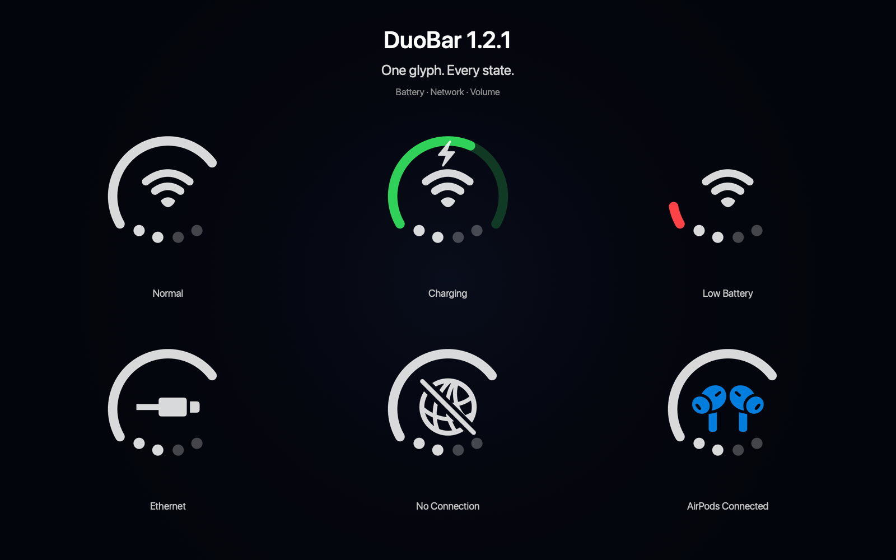
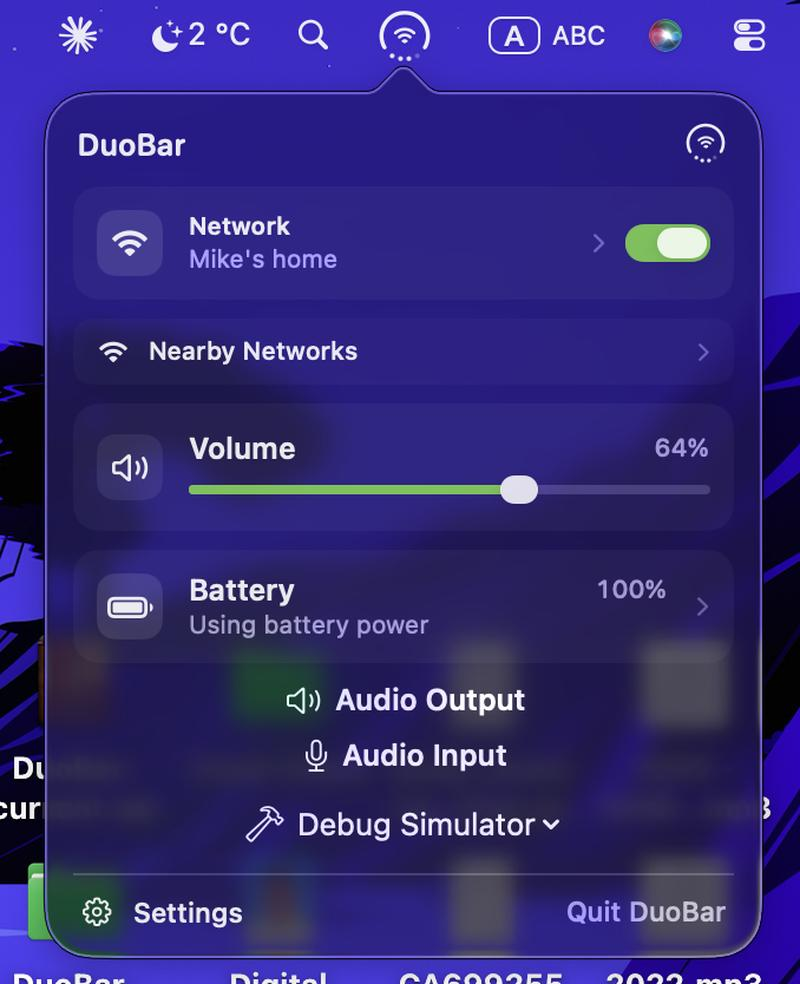

# DuoBar

[English](README.md) | [简体中文](README.zh-CN.md) | [Русский](README.ru.md) | [Українська](README.uk.md) | [ไทย](README.th.md)

Компактний індикатор для рядка меню macOS: акумулятор, мережа й гучність в одному значку.

[Завантажити DuoBar 1.4.0](https://github.com/Mikeli7666/DuoBar/releases/download/v1.4.0/DuoBar-1.4.0.dmg) · [Усі версії](https://github.com/Mikeli7666/DuoBar/releases) · [Повідомити про помилку](https://github.com/Mikeli7666/DuoBar/issues)

DuoBar 1.4.0 (збірка 9) · macOS 13+ · Apple Silicon та Intel · Universal 2 · Безкоштовний проєкт із відкритим кодом

  

  

## 📥 Встановлення для початківців

1. Відкрийте [реліз DuoBar 1.4.0](https://github.com/Mikeli7666/DuoBar/releases/tag/v1.4.0).
2. У розділі **Assets** завантажте **DuoBar-1.4.0.dmg**. Не завантажуйте `Source code (zip)` або `Source code (tar.gz)` — це вихідний код.
3. Двічі клацніть файл **DuoBar-1.4.0.dmg** і перетягніть **DuoBar.app** до **Applications / Програми**.
4. Відкрийте «Програми» та запустіть DuoBar. Це утиліта рядка меню, тому зазвичай вона не з’являється в Dock.

DuoBar 1.4.0 підписано Developer ID та нотаризовано Apple. Не потрібно вимикати Gatekeeper або SIP, використовувати Terminal, `sudo` чи `xattr`.

## Дозвіл геолокації та Wi‑Fi

Дозвіл «Геолокація» потрібен лише для відображення назви поточної Wi‑Fi мережі (SSID) через CoreWLAN. Відмова може приховати SSID, але базовий стан мережі працюватиме. DuoBar не відстежує та не передає фізичне місцезнаходження.

## Можливості

- Battery Ring: рівень акумулятора, заряджання, динамічна блискавка та необов’язкове кольорове кодування.
- Adaptive Ring на настільних Mac: Neutral за відсутності помітної продуктивної активності та автоматичне відображення навантаження на CPU, пам’ять або теплового стану за потреби.
- Деталі акумулятора на панелі: заряджання, призупинене заряджання або робота від адаптера, а також час до повного заряджання чи розряджання.
- Network: Wi‑Fi, Ethernet, офлайн-стан, SSID, публічний перемикач Wi‑Fi та поточна швидкість завантаження й відвантаження на панелі.
- Гучність: чотири крапки, повзунок, вимкнення/увімкнення звуку та вибір аудіовиходу.
- Тимчасове відображення AirPods/навушників, Open on Hover і регулювання розміру значка.
- Швидкі переходи до налаштувань Network, Battery і Sound.
- Панель Liquid Glass у macOS 26 і новіших (у раніших версіях — напівпрозорий дизайн).
- Необов’язковий значок у Dock (вимкнено за замовчуванням); клацання відкриває налаштування.
- English, 简体中文, 繁體中文, русский, українська та тайська.

  

  

## Системні вимоги та сумісність

- macOS 13.0 або новіша
- Apple Silicon або Intel, Universal 2
- Збірку та роботи з сумісності/надійності виконано з Xcode 27 і SDK macOS 27 зі збереженням підтримки macOS 13+. Це не є заявою про завершене тестування macOS 27 на реальному обладнанні.

## Безпека, обмеження та ліцензія

Системний стан обробляється локально: немає аналітики, відстеження, бекенду, телеметрії чи сторонніх мережевих запитів. DuoBar не сканує найближчі Wi‑Fi мережі, не підключається до них і не створює пару з Bluetooth-пристроями. Деякі зовнішні аудіопристрої не підтримують програмне керування гучністю.

SHA-256 офіційного DMG DuoBar 1.4.0:

`07a884f7a0b3a189546f0f39af6dcb13b53b8cb1d167c9f932258e44b6616045`

DuoBar поширюється за [MIT License](LICENSE).
